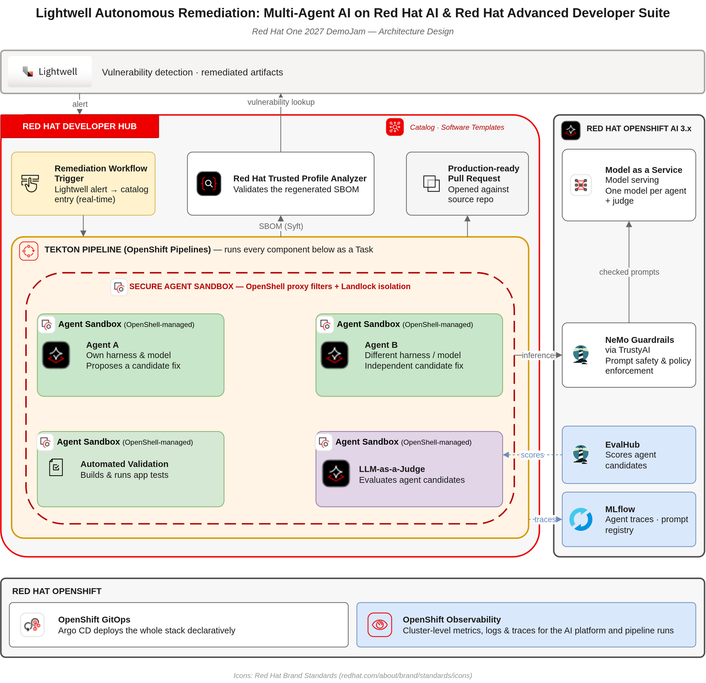

# Lightwell Autonomous Remediation

A Lightwell vulnerability alert goes in; a reviewed-ready pull request comes
out — with an exploit test that proves the fix, a regenerated inventory, and
the result checked in Red Hat Trusted Profile Analyzer. Built on OpenShift,
OpenShift Pipelines, OpenShift GitOps and Red Hat AI.

DemoJam | Red Hat One 2027 — [proposal](docs/DemoJam%20_%20Red%20Hat%20One%202027.pdf).

## Why it matters

- **Mean time to remediate in minutes, not days.** A vulnerability finding
  becomes a verified code change in 7–11 minutes, at about $1 of inference
  per remediation ([measurements](docs/measurements/)).
- **Evidence, not a version bump.** The agent decides whether the vulnerable
  code is actually reached, writes a test that fails while the application is
  exposed, and only delivers when that test passes after the change and
  nothing else broke. The pull request states what was proven and what was
  not.
- **The alert does not come back.** The bill of materials is rebuilt from the
  remediated build and validated in Trusted Profile Analyzer before merge.
- **Replicable by another team.** One `make deploy-all` against a fresh RHDP
  cluster; the platform is reconciled by OpenShift GitOps.

## What a run does

```
PipelineRun (vulnerability record)
  → analyse      is the vulnerable code reached?
  → baseline     the application's own tests are green before we touch it
  → demonstrate  an exploit test that fails on the vulnerable code
  → patch+verify the fix, the exploit test now green, no regression (one retry)
  → sbom         inventory regenerated from the remediated build → TPA
  → deliver      pull request with the evidence chain
```

One Tekton Task per phase, each gated on the previous one
([ADR-0009](docs/adr/0009-tekton-pipeline-orchestration.md)). The agent is
Claude Code running against Red Hat MaaS, with a per-role permission policy
([ADR-0002](docs/adr/0002-claude-code-maas-harness.md)). Whatever a script can
compute, a script computes; the agent is left the judgement
([ADR-0005](docs/adr/0005-determinism-boundary.md)).

## Architecture

**Today (Milestone 1, the submission):** single remediation agent, Tekton
orchestration, MaaS inference, TPA validation, on OpenShift.

```
Trigger          PipelineRun with the vulnerability record (ConfigMap)
Orchestration    OpenShift Pipelines — one Task per phase
Agent            Claude Code + Red Hat MaaS, in the agent runtime image
Inventory        Syft in the pipeline → Red Hat Trusted Profile Analyzer
Platform         OpenShift GitOps app-of-apps: Pipelines, RHOAI 3.5, MLflow
```

**Target (Milestone 2, RH One 2027):** two agents on different models, an
LLM-as-a-Judge choosing or combining their pull requests, Agent Sandbox /
OpenShell isolation, Lightwell webhook trigger, Developer Hub, MLflow tracing
and EvalHub.



## Replicate it

Full guide, with expected results at each step: **[docs/replicate.md](docs/replicate.md)**.

**Without anything** — no cluster, no credentials, no model:

```bash
for s in agent-runtime/test/fixtures/scenarios/*/; do scripts/remediate.sh --replay "$s"; done
```

**On a cluster**, on one of two paths: **A** with a Lightwell account (the
Apache CXF demo), **B** without one (`document-intake-service`, Maven Central
only).

| Prerequisite | |
|---|---|
| OpenShift 4.16+, cluster-admin | 16 CPU / 48 GiB minimum, no GPU. Validated on RHDP, OCP 4.21 |
| Red Hat MaaS API key | Validated with `claude-sonnet-4-6` |
| Your own copy of the application | From a template; **private** on path A, since the agent's pull requests show Lightwell data |
| GitHub fine-grained PAT | Scoped to that copy |
| Lightwell credentials | Path A only |
| Trusted Profile Analyzer | Optional |

```bash
gh repo create <you>/<app> --private \
  --template lightwell-remediation/document-intake-service  # path A: lw-apache-cxf-demo-template
cp secrets/secrets.template.env secrets/secrets.env      # fill it in, APP_REPO=<you>/<app>
(cd deploy && make deploy-all && make validate)          # the platform, via GitOps
scripts/push-secrets.sh && scripts/build-runtime-image.sh main
helm upgrade --install remediation-pipeline \
  deploy/gitops/deployments/agents/remediation-pipeline \
  -n lightwell-agents --set image.agent=<printed above>
scripts/run-remediation.sh deploy/pipelineruns/osv/GHSA-hfrx-6qgj-fp6c.json
                                     # path A: x_RHLW-CVE-2026-68079-4.2.2, fetched from Lightwell
```

## Red Hat products

| Product | Role | Version validated |
|---|---|---|
| Red Hat OpenShift (RHDP) | Platform | 4.21 |
| Red Hat OpenShift GitOps | Installs and reconciles the platform | `latest` channel |
| Red Hat OpenShift Pipelines | Orchestrates the remediation | 1.24 |
| Red Hat OpenShift AI | Platform for Milestone 2 (MLflow, TrustyAI, EvalHub) | 3.5 |
| Red Hat MaaS | Model inference | — |
| Red Hat Trusted Profile Analyzer | Validates the regenerated inventory | 3.1 |
| Red Hat Developer Hub | Milestone 2 (scaffolded, off) | — |

## Limitations

Milestone 1 is a single agent with no judge: a test can assert the defect
instead of the contract and still pass every deterministic gate, so the pull
request names the test it rests on for the reviewer. Runs start from a
PipelineRun rather than a webhook, there is no sandbox beyond the pod and the
permission policy yet, and path A needs Lightwell credentials. Details:
[docs/replicate.md — Limitations](docs/replicate.md#limitations-of-milestone-1).

## Repository

```
agent-runtime/   Harness launcher, permission policy per role, prompts, gates, image
deploy/          GitOps app-of-apps, Helm charts, Makefile, PipelineRun templates
scripts/         Run, replay, publish the demo app, push secrets, TPA onboarding
specs/           Behaviour specs (spec-driven development)
docs/            Guides, ADRs, measurements, ROADMAP
assets/          Architecture diagrams
secrets/         Credential template — real values are gitignored
```

## Documentation

- [Replicate the demo](docs/replicate.md)
- [Cluster bootstrap](deploy/README.md)
- [Orchestration — the Tekton Pipeline](docs/orchestration.md)
- [Agent runtime](docs/agent-runtime.md)
- [Demo narrative](docs/demo-narrative.md). The interactive page the video is recorded from lives in a private repository, `lightwell-remediation/lightwell-demo-page`, because it shows Lightwell data from real runs
- [Public target application](docs/target-app.md) — Lightwell-free app to remediate
- [Architecture Decision Records](docs/adr/README.md) · [summary](docs/stack-decisions.md)
- [Behaviour specs](specs/index.spec.md)
- [Measurements](docs/measurements/)
- [ROADMAP](docs/ROADMAP.md)

## Team

| Member | GitHub |
|--------|--------|
| Roman | [@rmarting](https://github.com/rmarting) |
| Roberto | [@rcarrata](https://github.com/rcarrata) |
| Carlos | [@cvicens](https://github.com/cvicens) |
| David | [@davidseve](https://github.com/davidseve) |

Contributing: feature branches `feat/<owner>/<topic>`, Conventional Commits,
one approval to merge into `main`. Agent conventions in [AGENTS.md](AGENTS.md).

## License

Apache-2.0
